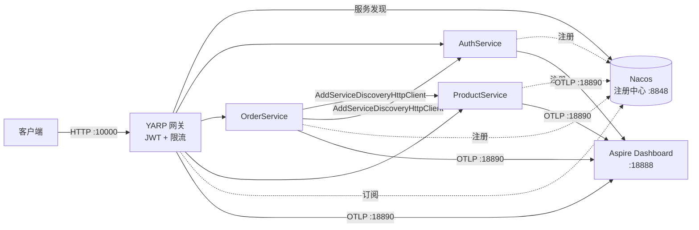

# AspNetCoreCloud

[](https://github.com/zhjgstc/AspNetCoreCloud/actions/workflows/ci.yml)


> 一个**面向 2026 的 .NET 微服务参考架构**：.NET 10 + YARP 网关 + Nacos 服务发现 + OpenTelemetry 可观测。
> 目标不是"能跑"，而是**让人 clone 下来一条命令就能看到完整调用链**。

```bash
docker compose -f deploy/compose/docker-compose.yml up -d --build
# 打开 http://localhost:10000/gateway   看网关路由与实时实例
# 打开 http://localhost:18848/nacos     看注册中心（默认免登录）
# 打开 http://localhost:18888           看链路 / 指标 / 日志（默认免登录）
```

---

## 为什么重写

原仓库是 .NET Core 3.0 + Ocelot + Consul + Apollo + Zipkin + Exceptionless 那一代方案。
2026 年这套已经全部过时：运行时已 EOL、Zipkin exporter 已弃用、Apollo 需要 MySQL + Java、Consul 需要额外运维。

这一版的原则是：**每一项能力只保留一个依赖，且都换成有官方长期支持的现代组件。**

| 能力 | 旧方案 | 现在 | 说明 |
|---|---|---|---|
| 运行时 | .NET Core 3.0（EOL） | **.NET 10 LTS** | Minimal Hosting，SDK 由 `global.json` 钉住 |
| 网关 | Ocelot | **YARP 2.3** | 微软官方，路由表可运行时热更新 |
| 服务注册发现 | Consul | **Nacos 2.5** | 自带控制台，注册/发现/健康检查一体 |
| 配置中心 | Apollo（MySQL + Java） | Nacos 配置 / `appsettings.json` | 详见下方"配置"一节 |
| 链路追踪 | zipkin4net 手写埋点 | **OpenTelemetry** | 自动埋点，业务代码零侵入 |
| 日志 | Exceptionless | **OTel Logs** | 与 trace 用同一个 traceId 串起来 |
| 看板 | Zipkin + Exceptionless 两套 | **Aspire Dashboard** | 一个容器同时看 trace/metrics/logs |
| 熔断 | Polly（demo 性质） | 网关主动健康检查 + 计划中 | 见路线图 |

---

## 架构



要点：

- **唯一入口是网关**。业务服务在 compose 里不映射宿主端口，外部访问不到它们。
- **服务之间调用也走服务发现**。`AddServiceDiscoveryHttpClient("product")` 每次请求解析一次实例地址，业务代码不知道自己跑在 Nacos 还是 K8s 上。
- **网关路由是动态的**。每 5 秒从 Nacos 拉一次实例表，原子替换 YARP 路由；注册中心不可用时退回 `appsettings.json` 里的静态兜底路由（`revision: fallback`）。
- **遥测直连 Dashboard**，中间不摆 Collector，少一个容器少一份配置。

---

## 目录结构

```
.
├── src/
│   ├── Gateway/                      # YARP 网关：JWT 鉴权 + 限流 + 动态路由
│   ├── Services/
│   │   ├── AuthService/              # :10100  签发/校验 token
│   │   ├── OrderService/             # :10200  跨服务调用示例
│   │   └── ProductService/           # :10300  可水平扩展的示例服务
│   └── BuildingBlocks/
│       ├── ServiceDiscovery.Abstractions/   # 零第三方包：接口 + HttpClient 解析器
│       ├── ServiceDiscovery.Nacos/          # 全仓库唯一引用 Nacos SDK 的地方
│       └── Observability/                   # 全仓库唯一引用 OTel 的地方
├── deploy/compose/
│   ├── docker-compose.yml            # 一键编排（默认不暴露业务端口）
│   ├── docker-compose.debug.yml      # override：把业务端口暴露出来便于调试
│   └── .env.example                  # 端口 / 版本 / 内存上限
├── scripts/                          # start / stop / status / logs / reset
├── Directory.Packages.props          # 中央包管理（CPM），版本号只维护一处
└── AspNetCoreCloud.slnx
```

**依赖方向是刻意的**：业务服务只依赖 `BuildingBlocks`，`BuildingBlocks` 之内才允许出现 Nacos / OTel。
所以换注册中心或换遥测后端，业务代码一行都不用动。

---

## 快速开始

### 方式一：Docker Compose（推荐）

前置：Docker（含 compose 插件）。

```bash
git clone https://github.com/zhjgstc/AspNetCoreCloud.git
cd AspNetCoreCloud

docker compose -f deploy/compose/docker-compose.yml up -d --build

bash scripts/status.sh          # 等全部 healthy，并打印访问地址
```

不想本地构建 4 个 .NET 镜像（约 3–5 分钟），可以直接用 CI 推送到 GHCR 的预构建镜像：

```bash
export IMAGE_PREFIX=ghcr.io/zhjgstc
export TAG=main                       # 或某个 tag，如 v2.0.0
docker compose -f deploy/compose/docker-compose.yml pull
docker compose -f deploy/compose/docker-compose.yml up -d --no-build
```

> 如果 pull 时报权限错误，说明包还没设为公开：
> 仓库 → Packages → 对应包 → Package settings → 把 visibility 改成 Public。

想看负载均衡：

```bash
docker compose -f deploy/compose/docker-compose.yml up -d --scale product=3
curl -s localhost:10000/gateway/token                      # 取 token
for i in $(seq 1 9); do
  curl -s -H "Authorization: Bearer <token>" localhost:10000/api/product/instance; echo
done                                                        # 会看到 3:3:3 轮询
```

停止：

```bash
docker compose -f deploy/compose/docker-compose.yml down        # 保留数据卷
docker compose -f deploy/compose/docker-compose.yml down -v     # 连 Nacos 数据一起清
```

`scripts/` 下的脚本是等价封装，会额外等待健康检查通过并打印地址：
`start.sh` / `stop.sh` / `status.sh` / `logs.sh` / `reset.sh`。

> 想从宿主直接访问业务服务（不经过网关）：
> `docker compose -f deploy/compose/docker-compose.yml -f deploy/compose/docker-compose.debug.yml up -d`
> 注意这时不能再用 `--scale`，端口会冲突。

### 方式二：本机 dotnet run

前置：.NET 10 SDK（`global.json` 钉 10.0.302）+ 一个能连上的 Nacos。

```bash
export Nacos__ServerAddresses__0=http://<nacos-host>:8848
export OTEL_EXPORTER_OTLP_ENDPOINT=http://<dashboard-host>:18890
export OTEL_EXPORTER_OTLP_PROTOCOL=http/protobuf

dotnet run --project src/Services/ProductService --urls http://0.0.0.0:10300
dotnet run --project src/Services/OrderService   --urls http://0.0.0.0:10200
dotnet run --project src/Services/AuthService    --urls http://0.0.0.0:10100
dotnet run --project src/Gateway                 --urls http://0.0.0.0:10000
```

不配 `OTEL_EXPORTER_OTLP_ENDPOINT` 时服务**只埋点不导出**，不会刷连接失败日志——本地没收集端也能安静地跑。

---

## 端口与端点

| 端口 | 服务 | 说明 |
|---|---|---|
| 10000 | Gateway | 唯一对外入口 |
| 10100 / 10200 / 10300 | Auth / Order / Product | 容器内端口，compose 默认不映射到宿主 |
| 18848 | Nacos 控制台 | standalone + Derby，demo 用 |
| 18888 | Aspire Dashboard | traces / metrics / logs |
| 18889 / 18890 | OTLP | 18889 = gRPC，18890 = HTTP/protobuf |

网关自带诊断端点：

| 端点 | 用途 |
|---|---|
| `GET /gateway` | 列出所有可用端点 |
| `GET /gateway/routes` | **最有用**：当前路由 + 每个服务的实例数与地址 |
| `GET /gateway/token` | demo 用的 JWT（生产必须关掉 `EnableDemoTokenEndpoint`） |
| `GET /health` `/health/live` `/health/ready` | 三态健康：总览 / 存活 / 就绪 |

业务示例：

| 端点 | 说明 |
|---|---|
| `GET /api/auth/health` | 匿名可达（`AnonymousPaths` 配置了 `/api/auth`） |
| `GET /api/auth/echo-token` | 回显 token 里的声明 |
| `GET /api/order/lb` | Order 连续调 Product 若干次，看实例分发 |
| `GET /api/product/instance` | 返回命中的实例（hostname + ip:port） |
| `GET /api/product/test` | 受保护路由，无 token 返回 401 |

---

## 控制台与账号密码

**这套编排里只有两个带 Web 后台的组件，demo 默认都是免登录的**，一条 `up` 之后直接点开就能用：

| 后台 | 地址 | 默认账号 | 默认密码 | 由哪个变量控制 |
|---|---|---|---|---|
| **Nacos 控制台** | http://localhost:18848/nacos | **无需登录**（鉴权关闭） | 无 | `NACOS_AUTH_ENABLE=false` |
| **Aspire Dashboard** | http://localhost:18888 | **无需登录**（匿名访问） | 无 | `DOTNET_DASHBOARD_UNSECURED_ALLOW_ANONYMOUS=true` |
| 网关 / Auth / Order / Product | — | 无后台，只有 HTTP 端点 | — | — |

### Nacos

- 默认 `NACOS_AUTH_ENABLE=false`，控制台**打开即可用，不弹登录框**。
- 想开鉴权：把 `deploy/compose/.env` 里的 `NACOS_AUTH_ENABLE` 改成 `true`，然后：
  1. Nacos **2.4 起不再内置默认密码**。首次访问控制台会引导你设置管理员密码；也可以调
     `POST http://localhost:18848/nacos/v1/auth/users/admin`（参数 `username`、`password`）预置。
     用户名沿用 `nacos`，密码就是你自己设的那个。
  2. 还要补 `NACOS_AUTH_TOKEN`（Base64，原始串 ≥ 32 字符）、`NACOS_AUTH_IDENTITY_KEY`、
     `NACOS_AUTH_IDENTITY_VALUE`，否则服务端起不来。
  3. 每个业务服务都要带上注册中心凭据，否则心跳/注册会 403 `user not found!`：

     ```yaml
     environment:
       Nacos__UserName: nacos
       Nacos__Password: <你设置的密码>
     ```

     本机 `dotnet run` 时用 `export Nacos__UserName=nacos` / `Nacos__Password=...` 即可。

### Aspire Dashboard

- 默认匿名访问，打开 `http://localhost:18888` 直接进。
- 想加登录：删掉 compose 里的 `DOTNET_DASHBOARD_UNSECURED_ALLOW_ANONYMOUS=true`。
  启动后日志会打印一次性登录地址，这样取：

  ```bash
  docker logs aspnetcorecloud-aspire-dashboard-1 2>&1 | grep -i "login"
  # 形如 http://localhost:18888/login?t=<token>
  ```

  这个 token **每次重启容器都会变**，不是固定密码。

### 网关的"账号"说明

网关本身没有后台登录页。受保护的业务路由需要 `Authorization: Bearer <token>`，
demo 阶段可以用 `GET /gateway/token` 现取一个（签发用的 key 写在
`src/Gateway/appsettings.json` 的 `Jwt:Key`，**生产必须换成密钥管理并关掉这个端点**）。

---

## 关键设计

**1. 服务发现抽象层**
`IServiceDiscovery` / `IServiceRegistry` 只有几个方法，Nacos 是它的一个实现。
`ServiceDiscoveryHttpMessageHandler` 挂在 HttpClient 上，每次请求解析地址，因此**实例上下线对调用方是立即生效的**。

**2. 换后端不改代码**
注册中心在 `ServiceDiscovery.Nacos` 里，遥测后端只由 `OTEL_EXPORTER_OTLP_ENDPOINT` 决定。
今天指向 Aspire Dashboard，明天指向 Jaeger / Grafana Tempo / 云厂商 SLS，代码不动。

**3. 网关是动态的，但不会"没有路由"**
`NacosProxyConfigProvider` 定时拉取并原子替换整张路由表；Nacos 挂掉时 `appsettings.json` 里的 `-fallback` 静态路由接管，服务不至于整体 404。

**4. K8s 与非 K8s 共用一套 `src`**
两条部署路径只替换三个点：服务发现（Nacos ↔ K8s Service DNS）、路由目标（动态 N 个 ↔ 静态 1 个）、配置来源（Nacos ↔ ConfigMap）。
当前仓库是**非 K8s 路径**，K8s 版本在路线图里。

**5. 噪声过滤是默认配置**
入站 `/health*`、出站 `/nacos/` 不生成 span——注册中心心跳每 5 秒一次，进链路纯属干扰。

---

## 已知取舍（读代码前建议先看）

完整记录见 [`改造计划-非K8s版-NET10-YARP-Nacos.md`](改造计划-非K8s版-NET10-YARP-Nacos.md)，其中 D1–D14 是实测踩过的坑，包括：

- Nacos SDK 的 gRPC 与 Nacos 2.5.x 握手不稳定 → 统一 `NamingUseRpc=false` 走 HTTP
- 服务端 UDP 推送的订阅缓存在容器/NAT 下收不到 → 网关 `UseSubscribeCache=false` 直查
- .NET 配置绑定器对集合是**追加**不是替换 → 集合类配置默认值一律留空
- Aspire Dashboard 13.x 的 OTLP 端口是分开的：18889 只有 gRPC，18890 才是 HTTP
- 官方 .NET 镜像已内置 uid 1654 的 `app` 用户 → Dockerfile 里不能再 `useradd` 同名 uid

**不建议直接上生产的地方**（demo 简化，清单在这，改完再上）：

- JWT 签名 key 写在 `appsettings.json` 里，必须换成密钥管理
- `/gateway/token` 是免登录签发端点，生产要关掉
- Nacos 是 standalone + Derby 且**默认关闭鉴权**，生产要集群 + 外置 MySQL + 开鉴权
- Aspire Dashboard 无鉴权、数据存内存、重启即丢，只适合本地和演示

---

## 路线图

- [x] **CI + GHCR**：`dotnet build` + compose 真机冒烟 + 四镜像推送（`.github/workflows/ci.yml`）
- [ ] **M6｜K8s 部署路径**：同一套 `src`，Helm chart，服务发现换成 K8s Service DNS
- [ ] 网关熔断与重试（YARP 需要自定义 `IForwarderHttpClientFactory`）
- [ ] Nacos 配置中心接入（替换 `appsettings.json` 中的环境相关配置）
- [ ] 生产级遥测后端切换示例（OTel Collector + Tempo / Jaeger）
- [ ] 清理历史遗留目录（`apollo-quick-start-1.5.0/`、`Exceptionless-5.0.0/`）
- [ ] GitHub Actions：构建镜像、跑 `dotnet build`、推送到 GHCR

---

## 历史版本

README 顶部的架构图与视频链接对应的是 2020 年的 .NET Core 3.0 版本（Ocelot + Consul + Apollo + Zipkin），
保留仅作对照，与当前代码**不一致**，请以本文和 `src/` 为准。

那一版已打 tag **`v1.0-netcore3.0`** 存档，可以随时 `git checkout v1.0-netcore3.0` 回去看。

## License

MIT
